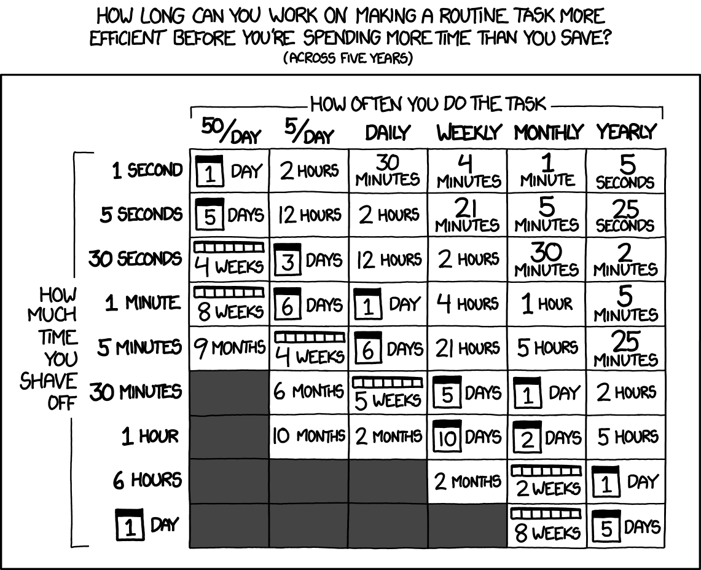
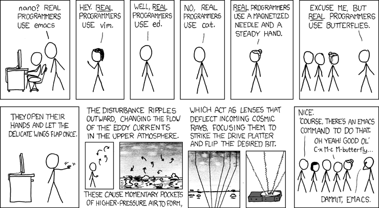

## `whoami`

- PhD in computer science, postdoc in SODA, now research engineer working on skrub, soon product engineer in Probabl (😲)
- Someone who lost a lot of time to avoidable pain
- **Everything here is personal experience. If there is a better way, do tell me.**

::: {.notes}
- Set expectations: this is a buffet, not a prescription.
- Ask people to write down 2–3 things they want to try — they'll forget the rest.
- Demos are live and might fail; that's part of the charm (and proof it's real).
:::

## Two laws to set the mood {.smaller}

> The best way to get the right answer on the Internet is not to ask a question; it's to post the wrong answer.
> — **Cunningham's Law**

- Today I will say wrong things on purpose[^1]. **Correct me.**

[^1]: Ok, not *on purpose*.


## The other law

> Premature optimization is the root of all evil. Yet we should not pass up our opportunities in that critical 3%.
> — **Knuth**

- Same for tooling: **don't** build a perfect pipeline on day 1.
- **Do** notice the critical 3%: the things you do 100×/day

  - searching files
  - navigating directories
  - installing things
  - "wait, which environment was this?"

## 


## Why bother?


## Why bother?

- You will need to re-run your analysis
  - Months later, for a rebuttal
  - More months later, for the camera ready
  - Even more months later, for a separate paper
- Reviewers / collaborators / your future self need **reproducibility**
  	- People will come back to your repo and try to replicate your results
- All time saved **compounds**: 10 min/day ≈ **40 hours/year**

::: {.tip}
The goal is not more tools. The goal is **fewer keystrokes for the things you do constantly**.
:::

## Roadmap

```{mermaid}
%%| fig-height: 3
flowchart LR
    A[The<br>shell] --> B[tmux: Remote &<br>long jobs]
    B --> C[Reproducible<br>Python]
    C --> D[Git]
    D --> G[vim,<br>just enough]
    G --> E[Writing &<br>diagrams]
    E --> F[AI]
```

::: {.notes}
Mention this is mermaid
:::

# Part 1 — The shell

## Living in the terminal: zsh

- Remote sessions means working from a terminal. **Decorate it.**
- Customize your shell config: `.zshrc`/`.bashrc`
- [Oh My Zsh](https://ohmyz.sh): themes + plugins
  - `zsh-autocomplete`
- Quick navigation with [zoxide](https://zoxide.org)

## Aliases: make frequent commands quick to type

```bash
alias ll='ls -lah'
alias gst='git status'
alias python='python3'
```

Some of the commands I use on a daily basis:
```bash
alias dc="pixi run -e doc build-doc-quick"
alias odo="open ~/work/skrub/doc/_build/html/index.html"
alias dtest='pixi run -e dev pytest -doctest-modules skrub skrub/_docs/modules --ignore-glob="*/test_*.py" --doctest-glob="*.rst"' --ignore-glob="doc/*"
```


::: {.notes}
- Show `~/.zshrc` briefly — don't read the whole file.
- Emphasize: aliases are personal. Mine are an example, make your own. 
:::

## 🎬 Demo 1 — Recall & navigate {.demo}

1. `Ctrl+R` (fuzzy history search via fzf)
2. `z myproj` — jump anywhere ([zoxide](https://zoxide.org))
3. Aliases

::: {.notes}
**Demo script** — config: `demo/shell-config/zshrc.snippet.zsh`
- `Ctrl+R` then `rsync` — history found instantly.
- `Ctrl+T` — fuzzy file picker with a live bat preview (toggle with `Ctrl+/`).
- `z work` → jumps to a deeply nested project dir. "No more `cd ../../../../`".
:::

## Finding things: ripgrep

- rip `grep` for a reason: **fast**, respects `.gitignore`, colourful

```bash
rg "def calculate_mean"            # search the repo
rg -i "todo"                       # case-insensitive
rg "import numpy" --type py        # only Python files
rg "error" -B 3 -A 3               # with context
rg "TODO|FIXME" --count            # how many things do I have left to do?
```

::: {.tip}
Pair it with `fzf`: `Ctrl+T` inserts any file path, fuzzy-matched.
:::

## Reading things: bat

- `cat` with syntax highlighting, line numbers, git gutter

```bash
bat script.py
bat script.py --line-range 10:20
git diff | bat          # readable diffs
```

::: {.notes}
Demo 2 combines ripgrep + bat: search for a function, then page to it. The point: you stop opening an IDE to find one line.
:::

## 🎬 Demo 2 — Search & read {.demo}

1. `rg "TODO"` across a messy project
2. `rg "learning_rate" --type py -C 2`
3. Pipe a file / diff into `bat`

::: {.notes}
**Demo script** — sample repo: `demo/messy-project/`
- `rg -c "TODO|FIXME"`: how how many things in the backlog? (`src/train.py`: 5)
- `rg learning_rate` hits 4 files; the "secret" one in `data/` stays hidden — `.gitignore` respected. Then `rg --no-ignore SECRET` finds it. "grep doesn't do that."
- Then read a hit comfortably: `bat src/train.py --line-range 1:25`.
:::

## Honorable mentions

- **`open .`** — open anything (folder, file, URL) from the shell
- **[nnn](https://github.com/jarun/nnn)** — terminal file manager, keyboard-only
- **[Raycast](https://www.raycast.com)** — Spotlight on steroids: clipboard history, window management
- **Custom search engines** — `z` + `Tab` in the browser -> search arXiv directly

# Part 2 — Long jobs & remote machines

## tmux: your terminal, inside your terminal

- **Sessions** survive SSH disconnects, laptop sleeps, crashed VPNs
- Split panes: run training + watch logs + edit, in one window
- Copy from the terminal to your OS clipboard

```bash
tmux new -s training     # start a session
Ctrl-b d                 # detach (job keeps running!)
tmux attach -t training  # reattach from anywhere
```

## 🎬 Demo 3 — tmux {.demo}

1. Split panes: run a "long job" + `watch` its log
2. Detach, close terminal entirely, reattach -> still running
3. Copy text from tmux to system clipboard

::: {.notes}
**Demo script** — script: `demo/tmux-demo/fake_train.py`
- Pane 1: `python3 fake_train.py | tee train.log`; split, pane 2: `tail -f train.log`.
- Detach, close the terminal, reopen, reattach.
- Copy a loss value from the log with tmux copy-mode -> paste in a chat window.
:::

## SSH without pain

- Key pairs (`ed25519`) → no more passwords
- `~/.ssh/config` → nicknames for clusters

```ssh-config
Host inria
     hostname ssh.saclay.inria.fr
     user rcappuzz

Host drago
    hostname %h.saclay.inria.fr
    ProxyCommand ssh inria /usr/bin/nc %h %p
    user rcappuzz
    ForwardAgent yes
```

Then simply: `ssh margaret`

## rsync > scp

- Copies **only what changed**
- Resumes copying from when it was interrupted

```bash
rsync -avz --exclude='*.npy' results/ drago:~/project/results/
rsync -avz --partial drago:~/big_output.h5 .
```

# Part 3 — Reproducible Python

## "It works on my machine"

But then:

- OS updates
- New python versions
- New package versions
- Functions are deprecated and removed
- Forgotten packages turn out to be vital


::: {.important}

The environment is part of the method section

:::

## pixi: environments as files

- One `pixi.toml` = python version + deps + **tasks**, cross-platform
- Conda ecosystem (CUDA, system libs) with a lockfile

```toml
[dependencies]
python = "3.11.*"
numpy  = ">=1.24,<2"
ruff   = ">=0.1"

[feature.dev.dependencies]
# Dependencies for a specific baseline
...

[tasks]
train = "python train.py"
test  = "pytest tests/"
# Combine complex tasks in a single command, set env variables
render = {cmd = "quarto render && cp -r slides/data/dataop_report/ _build/slides/data/", env = { "SKB_TABLE_REPORT_VERBOSITY" = "0" }}
# Have tasks depend on each other
serve = { cmd = "python -m http.server --directory _build 8000", depends-on = ["render"]}
```

```bash
# run the task `train` in the default environment
pixi run train
# run the same task in a different environment with a different baseline
pixi run -e special-baseline train
```

## uv: gotta go fast 🏎️

- pip/venv/pip-tools in one Rust binary, **10–100× faster**

```bash
uv init my-env && cd my-env
uv add numpy pandas matplotlib
uv run python analysis.py     # running from the `my-env` environment
uv pip install ... # Drop-in replacement for pip, 10x faster
```

::: {.tip}
Rule of thumb: **uv** for pure-Python projects, **pixi** for CUDA, tasks, environment-specific operations.
:::

## uv vs pixi


::: {.columns}

::: {.column}

### uv
- My "main" environment which I use for most operations
- Scratch, temporary environments to test specific package versions

:::

::: {.column}

### pixi
- Testing different package combinations
- Complex sequences of tasks
- Executing specific commands in specific environments

:::

:::

## 🎬 Demo 4 — env in 10 seconds {.demo}

1. `uv init` + `uv add` a stack 
2. `uv run` inside the project
3. Show `pixi.toml` + lockfile of a real project

::: {.notes}
**Demo script (to be built):**
- Time-box it: run `uv add numpy pandas scipy matplotlib`
- Show the `uv.lock` file 
- Sample project config lives in `demo/uv-pixi/pixi.toml`.
:::

## Pinning: boring, essential

- `numpy>=1.24` is not enough -- `numpy==1.24.3` is a necessity
  - Later package versions may break/deprecate functions your code relies on
- Lockfiles (`uv.lock`, `pixi.lock`) pin **everything**, transitively
- Rule: *`requirements.txt` pinned = the environment your results came from*

```text
numpy==1.24.3
pandas==2.1.1
matplotlib==3.8.0
```

## ruff: lint + format, one tool

- Replaces flake8, isort, black, pylint -- and it's **instant**

```toml
[tool.ruff]
line-length = 88

[tool.ruff.lint]
select = ["E", "F", "I", "N", "UP"]
```

```bash
ruff check .          # find problems
ruff check --fix .    # fix them
ruff format .         # black-style formatting
```

## 🎬 Demo 5 — ruff --fix {.demo}

1. `cd demo/ruff-demo && ruff check .` — everything wrong with the code
2. `ruff check --fix . && ruff format .`
3. `git diff` — same code, readable

::: {.notes}
**Demo script** — material: `demo/ruff-demo/ugly.py` (unsorted imports, `.format()`, bare `except`, `== None`, …)
- `ruff check .` — scroll the list briefly
- `ruff check --fix .` then `ruff format .` — the point is the *diff*
- `git diff` — imports sorted, f-strings, consistent style: same code, readable.
- Mention what `--fix` deliberately leaves: bare `except`, `== None` — semantic issues a linter shouldn't silently change.
- Reset before the talk: `demo/reset.sh`.
:::

## ipython: a (much) better python console

- `%history`, `?` and `??` for introspection
- Tab completion *everywhere*, even dict keys
- custom config -- same setup every time you run the console

```python
%autoreload 2
df.head?          # source of .head()
%run myscript.py
```

```shell
ipython -i myscript.py # execute script, then interactive mode
```

::: {.tip}

In a jupyter notebook:

- `%autoreload 2` -- edit module, REPL sees it instantly

:::

::: {.notes}
Quick mention — most people know Jupyter. The `%autoreload` trick is the one worth pausing on.
:::

# Part 4 — Git for research

## You're probably using git wrong (I did)

- **Commit often**, message like you'll read it in 6 months
- Commit **even more often** if you use AI agents to work on your code
  - They tend to break more things than you think (or want)
- Branches are free: experiments never touch `main`
- **Tag important results**: the exact code that produced Figure 3, the final version before the deadline

```bash
git checkout -b exp/nn-v2
git commit -m "Add dropout; accuracy 87.2% on val"
git tag -a v1.0-baseline
```

::: {.tip}
Use tags like a time machine: `git diff v1.0-baseline HEAD` shows *exactly* what changed between the two results in your paper.
:::

# Part 5 — Editing: vim, just enough

## 


## But why? Part 2

- It's on **every machine you'll ever SSH into** — clusters, servers, login nodes
- "How do I exit vim?" is a meme for a reason: it's worth to learn how to survive
- Modal editing = **verbs + nouns**
  - `INSERT`, `NORMAL`, `VISUAL`

::: {.tip}
You don't have to *live* in vim. Learn how to survive, then take the keybindings back to your IDE (with extensions).
:::

::: {.notes}
- Sell honestly: I'm not converting anyone to a vim lifestyle today.
- Two real wins: (1) never be helpless on a remote machine again, (2) modal motions speed up editing *anywhere* once your fingers know them.
- Mention `vimtutor` — 30 minutes in any terminal, teaches the survival kit properly.
:::

## Vim survival 101 

- **Modes**: `i` insert · `Esc` normal · `v` visual
 
- **Move**: `h j k l` · `w` `b` words · `0` `$` line ends · `gg` `G` file ends
 
- **Edit**: `dd` delete line · `yy` copy line · `p` paste · `u` undo · `Ctrl-r` redo
 
- **Search**: `/pattern` then `n`

- **Commands**: `:` followed by a letter -- write changes with `:w`

- **Actually exiting vim**: exit with `:q`, without saving with `:q!`, write and exit `:wq`

**The magic**: `ciw` change inner word · `ci"` inside quotes · `ci(` inside parens

::: {.tip}

Rebind your `CAPS` key to `Esc`. You'll thank me later.

:::

::: {.notes}
This is a cheat-sheet slide, not a lecture — it stays up while you talk. The game changer is `c` + a motion ("change until", "change inside"): once people see `ci"`, they understand why vim people are insufferable.
:::

## 🎬 Demo 6 — vim speedrun {.demo}

1. Open a file with 3 small bugs
2. Fix them: `/` to find, `ci"` to change a string, `dd` a stray line, `p` paste
3. `:wq` — hands never left the keyboard

::: {.notes}
**Demo script** — material: `demo/vim-demo/report.py` (3 deliberate bugs; answer key in `vim-demo/answer-key.md` — do NOT project it)
- Run it → `FileNotFoundError`: fix the path with `ci"` (`dat/` → `data/`).
- Run again → `NameError: late_pct`: `dd`, `k`, `p` to move the line up.
- Run again → works, but spams `DEBUG` lines: `2dd` kills both.
- Narrate verbs + nouns out loud. Optional flex: `:%s/DEBUG//gn` (dry-run count).
- Close: "vimtutor, 30 minutes. Then the VSCode Vim extension."
:::

## The pragmatic path

- **Level 1 -- survive**: learn how to exit vim, and how to edit in a minimal environment
- **Level 2 -- take it home**: vim keybindings in your editor
  - VSCode: *Vim* extension · PyCharm: *IdeaVim*
  - keep the IDE, learn the muscle memory
  - (it's how I picked up the habit!)
- **Level 3 — rabbit hole**: neovim & more

# Part 6 — Writing & diagrams

## Zotero: references on autopilot

[Zotero homepage](https://www.zotero.org)

- Browser connector grabs papers in one click, PDF + metadata
- Word/Google Docs/LaTeX integration -> no need to type citations by hand 
- Groups for lab reading lists

## Quarto: write once, publish everywhere

[Quarto homepage](https://quarto.org/docs/guide/)

- One `.qmd` (markdown + code) -> **PDF, HTML site, slides, Word**
- Code + output + prose live together -> results can't drift from text
- These slides? A Quarto file.

::: {.callout-warning}

Going from slides to blogs can be slightly to **extremely** janky. 

:::


## Diagrams as text: Mermaid & Graphviz

- Versionable, diffable, and fast to edit

```{mermaid}
%%| fig-height: 3.5
flowchart LR
    A[Read papers] --> B{Idea?}
    B -->|no| A
    B -->|yes| C[Experiment]
    C --> D{Works?}
    D -->|no| B
    D -->|yes| E[Write it up]
```

::: {.tip}
[Excalidraw](https://excalidraw.com) when you need to *think* freehand; Mermaid/Graphviz when the diagram needs to *live in the repo*.
:::

# Part 7 — AI, briefly

> *If you know the enemy and know yourself, you need not fear the result of a hundred battles.*
> — **Sun Tzu**

## AI assistants: be deliberate

- **Copilot**: work directly from your IDE, in your project
- **Agent harnesses**: OpenCode, pi.dev, Claude Code ... 
  - Give agents terminal access
  - Be mindful of permissions
- **OpenRouter**: one API key → hundreds of models, pay per token used
  - use cheap models for boilerplate, strong models for hard bugs
  - use strong models to draft instructions for cheaper models
  - open-weights models when privacy matters
- Your data / your paper drafts: **read the terms before feeding your data into the machine**

::: {.notes}
Keep this balanced and short: the audience ranges from AI-allergic to AI-dependent. The cost math slide from the outline is available in the repo.
:::

## Don't know where to start? 

::: {.tip}

Describe your workflow to an AI chat, ask for suggestions on how to be more productive.

It's how I found out about many of these tools.

:::


## The first draft of this talk? 

0.04€ with GLM-5.3 Flash on OpenRouter


# Wrap-up

## TL;DR — if you only take 5 things

1. **zoxide + fzf** in your shell
2. **tmux** on every remote machine: persist long jobs, multi-screen support, copy/paste 
3. **uv or pixi**: your environment *is* part of your methods
4. **ruff**: improve your code quality with no effort
5. **git tags**: trace back to the exact commits months down the line

## Steal this

- Slides & examples: `<<repo-url>>`
  - `.zshrc.example`, `tmux.conf.example`, `pixi.toml`, `ruff.toml`…
- Correction welcome: **Cunningham's Law is in effect** — tell me what I got wrong

::: {.notes}
End with the disclaimer from the start. Q&A. Have a terminal open in tmux, because the best demos happen when someone asks "can it do X?"
:::
