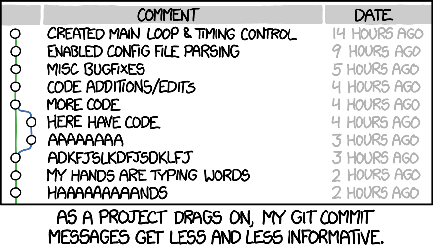

## `whoami`

- PhD in computer science, postdoc in SODA, now research engineer working on skrub, soon product engineer in Probabl (😲)
- Someone who lost a lot of time to avoidable pain
- **Everything here is personal experience. If there is a better way, do tell me.**

::: {.notes}
- Set expectations: this is a buffet, not a prescription.
- Ask people to write down 2–3 things they want to try — they'll forget the rest.
- Demos are live and might fail; that's part of the charm (and proof it's real).
:::

## Two laws to set the mood {.smaller}

> The best way to get the right answer on the Internet is not to ask a question; it's to post the wrong answer.
> — **Cunningham's Law**

- If I say something wrong, **correct me.**


## The other law

> Premature optimization is the root of all evil. Yet we should not pass up our opportunities in that critical 3%.
> — **Knuth's adage**

- Same for tooling: **don't** build a perfect pipeline on day 1.
- **Do** notice the critical 3%: the things you do 100×/day

  - searching files
  - navigating directories
  - installing things

## 


## Why bother? Reproducibility! 

- You will need to re-run your analysis
  - Months later, for a rebuttal
  - More months later, for the camera ready
  - Even more months later, for a separate paper
- Reviewers / collaborators / your future self need **reproducibility**
  	- People will come back to your repo and try to replicate your results

## Why bother? Time savings! 

- All time saved **compounds**: 10 min/day ≈ **40 hours/year**
  - More time to work, or to party 💃
- Reliable workflow and code -> less time wasted fixing avoidable problems 

::: {.tip}
The goal is not more tools. The goal is **fewer keystrokes for the things you do all the time**.
:::

## Why bother?


::: {.tip}

I did the research, you reap the benefits!

::: 

## Roadmap

```{mermaid}
%%| fig-height: 3
flowchart LR
    A[The<br>shell] --> B[tmux: Remote &<br>long jobs]
    B --> C[Reproducible<br>Python]
    C --> D[Git]
    D --> G[vim,<br>just enough]
    G --> E[Writing &<br>diagrams]
    E --> F[AI]
```

::: {.notes}
Mention this is mermaid
:::

# Part 1 — The shell

##
```{mermaid}
%%| fig-height: 3
flowchart LR
    A[The<br>shell] --> B[tmux: Remote &<br>long jobs]
    B --> C[Reproducible<br>Python]
    C --> D[Git]
    D --> G[vim,<br>just enough]
    G --> E[Writing &<br>diagrams]
    E --> F[AI]

    classDef highlight fill:#2a9d8f,stroke:#1d7a6e,color:#fff,font-weight:bold
    classDef dim fill:#e9ecef,stroke:#ced4da,color:#868e96
    class A highlight
    class B,C,D,G,E,F dim
```


- .zshrc
- Themes and plugins: Oh my zsh
- Aliases
- Folder navigation: zoxide
- Searching the history
- Search text: `ripgrep`
- Read text: `bat`

## Living in the terminal: zsh

- Remote sessions means working from a terminal. **Decorate it.**
- Customize your shell config: `.zshrc`/`.bashrc`
- [Oh My Zsh](https://ohmyz.sh): themes + plugins
  - `zsh-autocomplete`


## Aliases

- `alias` lets you replace a full command with a shorthand
- No need to remember the actual command
- Much faster to type

```bash
alias ll='ls -lah'
alias gst='git status'
alias python='python3'
```

Some aliases I use on a daily basis:

```bash
alias dc="pixi run -e doc build-doc-quick"
alias odo="open ~/work/skrub/doc/_build/html/index.html"
alias dtest='pixi run -e dev pytest -doctest-modules skrub skrub/_docs/modules --ignore-glob="*/test_*.py" --doctest-glob="*.rst"' --ignore-glob="doc/*"
```

## Shell history

```shell
Ctrl+R 
```

## Finding things: ripgrep

- rip `grep` for a reason: **fast**, respects `.gitignore`, colourful

```bash
rg "def calculate_mean"            # search the repo
rg -i "todo"                       # case-insensitive
rg "import numpy" --type py        # only Python files
rg "error" -B 3 -A 3               # with context
rg "TODO|FIXME" --count            # how many things do I have left to do?
```

::: {.tip}
Pair it with `fzf`: `Ctrl+T` inserts any fuzzy-matched file path.
:::

## Reading things: bat

- `cat` with syntax highlighting, line numbers, git gutter

```bash
bat script.py
bat script.py --line-range 10:20
bat -p script.py # plain output (better for copying)
```

## Honorable mentions

- **`open .`** — open anything (folder, file, URL) from the shell
- **[nnn](https://github.com/jarun/nnn)** — terminal file manager, keyboard-only
- **Custom search engines** — `z` + `Tab` in the browser -> search arXiv directly

Mac only:

- `pbcopy` and `pbpaste`: copy/paste from command line to OS clipboard
- **[Raycast](https://www.raycast.com)** — Spotlight on steroids: clipboard history, window management

# Part 2 — Long jobs & remote machines

##
```{mermaid}
%%| fig-height: 3
flowchart LR
    A[The<br>shell] --> B[tmux: Remote &<br>long jobs]
    B --> C[Reproducible<br>Python]
    C --> D[Git]
    D --> G[vim,<br>just enough]
    G --> E[Writing &<br>diagrams]
    E --> F[AI]

    classDef highlight fill:#2a9d8f,stroke:#1d7a6e,color:#fff,font-weight:bold
    classDef dim fill:#e9ecef,stroke:#ced4da,color:#868e96
    class B highlight
    class A,C,D,G,E,F dim
```

- tmux
- SSH configuration
- rsync

## tmux: your terminal, inside your terminal

- **Sessions** survive SSH disconnects, laptop sleeps, crashed VPNs
- Split panes: run training + watch logs + edit, in one window
- Copy from the terminal to your OS clipboard

```bash
tmux new -s training     # start a session
Ctrl-b d                 # detach (job keeps running!)
tmux attach -t training  # reattach from anywhere
```

## SSH without pain

- Key pairs (`ed25519`) → no more passwords
- `~/.ssh/config` → nicknames for clusters

```ssh-config
Host inria
     hostname ssh.saclay.inria.fr
     user rcappuzz

Host drago
    hostname %h.saclay.inria.fr
    ProxyCommand ssh inria /usr/bin/nc %h %p
    user rcappuzz
    ForwardAgent yes
```

Then simply: `ssh margaret`

## rsync > scp

- Copies **only what changed**
- Resumes copying from when it was interrupted

```bash
rsync -avz --exclude='*.npy' results/ drago:~/project/results/
rsync -avz --partial drago:~/big_output.h5 . # partial resumes the transfer if it drops
```

# Part 3 — Reproducible Python

##
```{mermaid}
%%| fig-height: 3
flowchart LR
    A[The<br>shell] --> B[tmux: Remote &<br>long jobs]
    B --> C[Reproducible<br>Python]
    C --> D[Git]
    D --> G[vim,<br>just enough]
    G --> E[Writing &<br>diagrams]
    E --> F[AI]

    classDef highlight fill:#2a9d8f,stroke:#1d7a6e,color:#fff,font-weight:bold
    classDef dim fill:#e9ecef,stroke:#ced4da,color:#868e96
    class C highlight
    class B,A,D,G,E,F dim
```

- Pinning requirements
- pixi: lockfile, multiple environments, tasks
- uv: lightning fast environments
- ruff: code formatting
- ipython: a much better python console

## "It works on my machine"

But then:

- OS updates
- New python versions
- New package versions
- Functions are deprecated and removed
- Forgotten packages turn out to be vital


::: {.important}

The environment is part of the method

:::

## Pinning: boring, essential

- `numpy>=1.24` is not enough -- `numpy==1.24.3` is a necessity
  - Later package versions may break/deprecate functions your code relies on
- Lockfiles (`uv.lock`, `pixi.lock`) pin **everything**, transitively
- Rule: *`requirements.txt` pinned = the environment your results came from*

```text
numpy==1.24.3
pandas==2.1.1
matplotlib==3.8.0
```


## uv: gotta go fast 🏎️

- pip/venv/pip-tools in one Rust binary, **10–100× faster**

```bash
uv init my-env && cd my-env
uv add numpy pandas matplotlib
uv run python analysis.py     # running from the `my-env` environment
```

- Replace `venv` and `pip`:

```bash
uv venv my-env
source my-env/bin/activate
uv pip install pandas scikit-learn
```


## pixi: environments as files

- One `pixi.toml` = python version + deps + **tasks**, cross-platform
- Conda ecosystem (CUDA, system libs) with a lockfile

```toml
[dependencies]
python = "3.11.*"
numpy  = ">=1.24,<2"
ruff   = ">=0.1"

[feature.special.dependencies]
# Dependencies for a specific baseline
...
```


## pixi: define and run complex tasks
```toml
[tasks]
train = "python train.py"
test  = "pytest tests/"
# Combine complex tasks in a single command, set env variables
render = {cmd = "quarto render && cp -r slides/data/dataop_report/ _build/slides/data/", env = { "SKB_TABLE_REPORT_VERBOSITY" = "0" }}
# Have tasks depend on each other
serve = { cmd = "python -m http.server --directory _build 8000", depends-on = ["render"]}
```

```bash
# run the task `train` in the default environment
pixi run train
# run the training in the environment `special`
pixi run -e special train
```


## uv vs pixi


::: {.columns}

::: {.column}

### uv
- My "main" environment which I use for most operations
- Scratch, temporary environments to test specific package versions

:::

::: {.column}

### pixi
- Testing different package combinations
- Complex sequences of tasks
- Executing specific commands in specific environments

:::

:::

::: {.tip}
Rule of thumb: **uv** for pure-Python projects, **pixi** for CUDA, tasks, environment-specific operations.
:::

## ruff: clean up your codebase

- Linting and formatting in one tool
- Replaces flake8, isort, black, pylint -- and it's **instant**

```toml
[tool.ruff]
line-length = 88

[tool.ruff.lint]
select = ["E", "F", "I", "N", "UP"]
```

```bash
ruff check .          # find problems
ruff check --fix .    # fix them
ruff format .         # black-style formatting
```

## ipython: a (much) better python console

- `%history`, `?` and `??` for introspection
- Tab completion *everywhere*, even dict keys
- custom config -- same setup every time you run the console

```python
df.head?          # source of .head()
%run myscript.py
```

```shell
ipython -i myscript.py # execute script, then interactive mode
```

::: {.tip}

In a jupyter notebook:

- `%autoreload 2` -- edit module, REPL sees it instantly

:::


# Part 4 — Git for research


## 
```{mermaid}
%%| fig-height: 3
flowchart LR
    A[The<br>shell] --> B[tmux: Remote &<br>long jobs]
    B --> C[Reproducible<br>Python]
    C --> D[Git]
    D --> G[vim,<br>just enough]
    G --> E[Writing &<br>diagrams]
    E --> F[AI]

    classDef highlight fill:#2a9d8f,stroke:#1d7a6e,color:#fff,font-weight:bold
    classDef dim fill:#e9ecef,stroke:#ced4da,color:#868e96
    class D highlight
    class B,C,A,G,E,F dim
```



## You're probably using git wrong (I did)

- **Commit often**, message like you'll read it in 6 months
- Commit **even more often** if you use AI agents to work on your code
  - They tend to break more things than you think (or want)
- Branches are free: experiments never touch `main`
- **Tag important results**: the exact code that produced Figure 3, the final version before the deadline

```bash
git checkout -b exp/nn-v2 # create a new branch
git commit -m "Add dropout; accuracy 87.2% on val"
git tag -a v1.0-baseline
```

::: {.tip}
Use tags like a time machine: `git diff v1.0-baseline HEAD` shows *exactly* what changed between the two results in your paper.
:::

# Part 5 — Editing: vim, just enough

## 

```{mermaid}
%%| fig-height: 3
flowchart LR
    A[The<br>shell] --> B[tmux: Remote &<br>long jobs]
    B --> C[Reproducible<br>Python]
    C --> D[Git]
    D --> G[vim,<br>just enough]
    G --> E[Writing &<br>diagrams]
    E --> F[AI]

    classDef highlight fill:#2a9d8f,stroke:#1d7a6e,color:#fff,font-weight:bold
    classDef dim fill:#e9ecef,stroke:#ced4da,color:#868e96
    class G highlight
    class B,C,D,A,E,F dim
```
## 
- Why? 
- Survive! 
- Edit! 


## 


## But why? Part 2

- It's on **every machine you'll ever SSH into** — clusters, servers, login nodes
- "How do I exit vim?" is a meme for a reason: it's worth to learn how to survive
- Modal editing = **verbs + nouns**
  - `INSERT`, `NORMAL`, `VISUAL`
- Editing becomes _fast_ and _fun_[^1]

[^1]: (ok maybe the latter is only for me)

::: {.tip}
You don't have to *live* in vim. Learn how to survive, then take the keybindings back to your IDE (with extensions).
:::

::: {.notes}
- Sell honestly: I'm not converting anyone to a vim lifestyle today.
- Two real wins: (1) never be helpless on a remote machine again, (2) modal motions speed up editing *anywhere* once your fingers know them.
- Mention `vimtutor` — 30 minutes in any terminal, teaches the survival kit properly.
:::

## Vim survival 101 

- **Modes**: `i` insert · `Esc` normal · `v` visual
 
- **Move**: `h j k l` · `w` `b` words · `0` `$` line ends · `gg` `G` file ends
 
- **Edit**: `dd` delete line · `yy` copy line · `p` paste · `u` undo · `Ctrl-r` redo
 
- **Search**: `/pattern` then `n`

- **Commands**: `:` followed by a letter -- write changes with `:w`

- **Actually exiting vim**: exit with `:q`, without saving with `:q!`, write and exit `:wq`

**The magic**: `ciw` change inner word · `ci"` inside quotes · `ci(` inside parens

::: {.tip}

Rebind your `CAPS` key to `Esc`. You'll thank me later.

:::

::: {.notes}
This is a cheat-sheet slide, not a lecture — it stays up while you talk. The game changer is `c` + a motion ("change until", "change inside"): once people see `ci"`, they understand why vim people are insufferable.
:::

## The pragmatic path

- **Level 1 -- survive**: learn how to exit vim, and how to edit in a minimal environment
- **Level 2 -- take it home**: vim keybindings in your editor
  - VSCode: *Vim* extension · PyCharm: *IdeaVim*
  - keep the IDE, learn the muscle memory
  - (it's how I picked up the habit!)
- **Level 3 — rabbit hole**: neovim & more

# Part 6 — Writing & diagrams


## 
```{mermaid}
%%| fig-height: 3
flowchart LR
    A[The<br>shell] --> B[tmux: Remote &<br>long jobs]
    B --> C[Reproducible<br>Python]
    C --> D[Git]
    D --> G[vim,<br>just enough]
    G --> E[Writing &<br>diagrams]
    E --> F[AI]

    classDef highlight fill:#2a9d8f,stroke:#1d7a6e,color:#fff,font-weight:bold
    classDef dim fill:#e9ecef,stroke:#ced4da,color:#868e96
    class E highlight
    class B,C,D,G,A,F dim
```
## 
- References with Zotero
- Authoring with Quarto
- Diagrams: excalidraw, mermaid, graphviz

## Zotero: references on autopilot

[Zotero homepage](https://www.zotero.org)

- Browser connector grabs papers in one click, PDF + metadata
- Word/Google Docs/LaTeX integration -> no need to type citations by hand 
- Groups for lab reading lists

## Quarto: write once, publish everywhere

[Quarto homepage](https://quarto.org/docs/guide/)

- One `.qmd` (markdown + code) -> **PDF, HTML site, slides, Word**
- Code + output + prose live together -> results can't drift from text
- These slides? A Quarto file.

::: {.callout-warning}

Going from slides to blogs can be slightly to **extremely** janky. 

:::


## Diagrams as text: Mermaid & Graphviz

- Versionable, diffable, and fast to edit

```{mermaid}
%%| fig-height: 3.5
flowchart LR
    A[Read papers] --> B{Idea?}
    B -->|no| A
    B -->|yes| C[Experiment]
    C --> D{Works?}
    D -->|no| B
    D -->|yes| E[Write it up]
```

::: {.tip}
[Excalidraw](https://excalidraw.com) when you need to *think* freehand; Mermaid/Graphviz when the diagram needs to *live in the repo*.
:::

# Part 7 — AI, briefly

##
```{mermaid}
%%| fig-height: 3
flowchart LR
    A[The<br>shell] --> B[tmux: Remote &<br>long jobs]
    B --> C[Reproducible<br>Python]
    C --> D[Git]
    D --> G[vim,<br>just enough]
    G --> E[Writing &<br>diagrams]
    E --> F[AI]

    classDef highlight fill:#2a9d8f,stroke:#1d7a6e,color:#fff,font-weight:bold
    classDef dim fill:#e9ecef,stroke:#ced4da,color:#868e96
    class F highlight
    class B,C,D,G,E,A dim
```

## 
> *If you know the enemy and know yourself, you need not fear the result of a hundred battles.*
> — **Sun Tzu**


## AI assistants: be deliberate

- **Any LLM chat**: paste into your code
- **Copilot**: work directly from your IDE, in your project
- **Agent harnesses**: OpenCode, pi.dev, Claude Code ... 
  - Give agents terminal access
  - Be mindful of permissions

::: {.tip}

Describe your workflow to an AI chat, ask for suggestions on how to be more productive.

It's how I found out about many of these tools.

:::

## Cheap models, good models
- **[OpenRouter](https://openrouter.ai/)**: one API key -> hundreds of models, pay per token used
  - use cheap models for boilerplate, strong models for hard bugs
  - use strong models to **draft instructions** for cheaper models
- Your data / your paper drafts: **read the terms before feeding your data into the machine**


## The first draft of this talk? 

0.04€ with GLM-5.3 Flash on OpenRouter


# Wrap-up

## TL;DR — if you only take 5 things

1. **zoxide + aliases** in your shell
2. **tmux** on every remote machine: persist long jobs, multi-screen support, copy/paste 
3. **uv or pixi**: your environment *is* part of your methods
4. **ruff**: improve your code quality with no effort
5. **git tags**: trace back to the exact commits months down the line

## Steal this

- Slides & examples: `https://github.com/rcap107/tooling-talk`
  - `.zshrc.example`, `tmux.conf.example`, `pixi.toml`, `ruff.toml`…
- Correction welcome: **Cunningham's Law is in effect** — tell me what I got wrong
